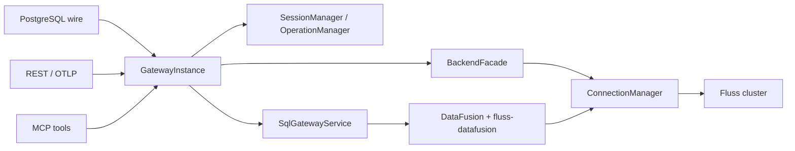

# fluss-gateway 临时 Review Issue 清单

日期：2026-06-23

范围：静态代码审查 + Rust / Fluss / Gateway 架构三个子代理视角汇总。此文件用于后续拆分正式 issue 和逐项重构；本次未修改业务代码，也未运行测试。

优先级说明：

- P0：生产正确性或资源风险，建议优先处理。
- P1：协议兼容、Fluss 语义兼容或架构契约缺口。
- P2：可运维性、性能、测试覆盖或未来演进风险。

## 当前架构概览

整体边界方向是合理的：协议入口依赖 `GatewayInstance`，SQL 路径和 direct write 路径相对分离。主要问题在于不少已经建模的架构契约没有被执行路径真正消费，包括 cluster scope、deadline/cancel、metadata cache、pg_catalog overlay、PostgreSQL streaming/cursor 语义、Fluss principal/authorization 语义。

## GW-001 [P0] PostgreSQL 查询结果全量物化，`max_rows` / portal 语义未实现

影响：

- 大结果集会在 gateway 进程中无界累积，客户端必须等全量 drain 后才能收到首行。
- PostgreSQL extended query 的 portal `max_rows` 被忽略，不支持 cursor/fetch 分页语义。
- 取消请求和客户端断开不能及时打断全量物化路径。

代码证据：

- `src/server/postgres/handler.rs:238-243`：`do_query` 收到 `_max_rows` 但未使用。
- `src/server/postgres/handler.rs:471-492`：Arrow stream 被 drain 到 `Vec<Result<_, PgWireError>>`，再用 `stream::iter(rows)` 构造 `QueryResponse`。
- `src/server/postgres/handler.rs:463-489`：cancel registry 只在 drain 前后 set/clear；若物化耗时很长，协议侧背压不会传导到 DataFusion stream。

测试复现方法：

- 新增 PostgreSQL extended query 测试：prepare/portal execute `SELECT * FROM large_table`，传 `max_rows = 1`，期望只返回 1 行并保持 portal 可继续 fetch；当前会忽略 `max_rows`。
- 新增大结果集流式测试：构造返回多批 Arrow batch 的 fake `GatewayInstance`，连接 PG 后读取首行，断言在全部 batch 生产完成前客户端能收到首行；当前需要全部 drain 完成。
- 新增断开/取消测试：客户端在查询未完成时关闭 socket 或发送 cancel request，断言 operation 进入 terminal 状态且 cancel registry 被清理。

修复方向：

- 将 Arrow batch -> PG `DataRow` 做成真正的 stream adapter，直接交给 `QueryResponse::new`。
- 支持 portal `max_rows` / suspension / resume。
- 给 row stream 增加 drop guard，确保 EOF、错误、客户端提前断开都会清理 running operation。

## GW-002 [P0] timeout / deadline / cancel 字段已建模但未接入执行路径

影响：

- `SET statement_timeout` 或 per-request timeout 看起来可用，实际不会中止长查询。
- REST direct path 有 `deadline` / `cancel` 字段，但当前没有服务端 deadline，也没有接入客户端断开。
- `TimedOut` 状态和 504 映射难以真实触发，接口契约与行为不一致。

代码证据：

- `src/types.rs:189-195`：`SqlExecutionOptions.request_timeout` 已定义。
- `src/session/session.rs:244-258`：`effective_timeout()` 已实现 `statement_timeout` 与 request override 的 min 规则。
- `src/sql/gateway_service.rs:145-207`：`execute_sql()` 未读取 `req.options.request_timeout`，也未读取 session `statement_timeout`。
- `src/sql/gateway_service.rs:351-361`：`tracked_stream()` 只 select cancel token 和 inner stream，没有 timeout 分支。
- `src/server/rest/mod.rs:237-245`：REST context 固定 `deadline: None`，`cancel` 也只是新建 token。

测试复现方法：

- PG 集成测试：执行 `SET statement_timeout = '1ms'` 后运行一个长查询或阻塞 fake stream，期望返回 timeout 错误且 operation 状态为 `TimedOut`；当前查询不会按 timeout 终止。
- SQL service 单测：构造 `ExecuteSqlRequest { options.request_timeout = Some(...) }`，用不会结束的 fake stream，断言超时后 cancel token fired、operation terminal。
- REST direct 测试：注入一个阻塞 backend/write path，并设置请求 deadline 或模拟客户端断开，期望 backend 能观察 cancel/deadline。

修复方向：

- 引入统一 `DeadlineContext`：合并 session `statement_timeout`、per-request timeout、REST request deadline。
- 在 planning、`collect()`、`execute_stream()`、stream polling 外层接入 `tokio::time::timeout` 或 timeout-aware stream。
- 超时后标记 `TimedOut`，触发 cancel token，并返回 `GatewayError::Timeout`。

## GW-003 [P0] operation / session 生命周期缺少清理闭环

影响：

- `op_index` 和 per-session `OperationManager.operations` 只增不减，长时间运行会积累 stale operation。
- session close 只从 session map 移除 session，不清理 `op_index`。
- `reap_idle()` 已实现但生产没有定时调用，空闲或半断开 session 可能泄漏。

代码证据：

- `src/instance/gateway_instance.rs:64-67`：`op_index` 记录 operation -> session。
- `src/instance/gateway_instance.rs:179-190`：每次 `execute_sql()` 都 insert `op_index`，未看到对应 remove。
- `src/session/operation.rs:207-266`：`OperationManager` 提供 register/status/cancel/with_operation，但没有 remove / prune API。
- `src/session/manager.rs:122-130`：`close()` 只 remove session 并调用 `session.close()`。
- `src/session/session.rs:235-241`：session close 只 cancel active operations，不等待也不清理 terminal operation。
- `src/session/manager.rs:141-165`：`reap_idle()` 存在。
- `src/main.rs:390-395`：生产组装只创建 `SessionManager`，没有启动周期性 reaper task。

测试复现方法：

- 单测：打开 session，执行 N 次返回 command/query 的 fake SQL，关闭 session，断言 `op_index` 长度归零；当前没有清理接口，预期会失败或无法断言。
- MCP 集成测试：连续调用 MCP query 产生临时 session，查询完成后检查 session/operation registry 没有增长。
- idle reaper 测试：启动 gateway 后打开 PG session 并空闲超过 `idle_timeout`，断言 session 被回收；当前生产路径不会自动调用 `reap_idle()`。

修复方向：

- `OperationManager` 增加 remove/prune API，支持 terminal retention TTL / LRU 上限。
- `close_session` 和 idle reap 时同步清理该 session 的 `op_index`。
- gateway lifecycle 启动 interval reaper，并在 shutdown 时停止和 join。

## GW-004 [P0] REST `{cluster}` scope 未校验，backend 忽略 scope；`FLUSS_CLUSTER` 与 single-default registry 语义冲突

影响：

- `/v1/clusters/foo/...` 可能表面访问成功，但实际访问默认 Fluss cluster，破坏租户/多集群边界。
- 配置 `FLUSS_CLUSTER != default` 时，启动路径会用该 cluster 去 single-default registry 里解析，容易启动失败。
- 当前 API 表面暴露多集群路径，但实现是单集群，契约不清晰。

代码证据：

- `src/server/rest/mod.rs:225-245`：`make_context()` 直接把 path 中的 `cluster` 填入 `RequestExecutionContext`，没有校验。
- `src/backend/mod.rs:315-364`：`list_databases/list_tables/get_table_info/create_table` 的 `MetadataScope` 参数名是 `_scope`，实现不消费 cluster。
- `src/cluster/mod.rs:42-59`：`ClusterRegistry::single_default()` 只注册 `ClusterId("default")`。
- `src/main.rs:338-352`：启动时使用 `GatewayConfig.cluster` 解析连接，但 registry 只包含 `default`。

测试复现方法：

- REST 集成测试：对同一个 gateway 调用 `/v1/clusters/default/...` 和 `/v1/clusters/not-default/...`，期望后者返回 400 `unknown cluster`；当前可能访问默认集群数据。
- 启动测试：设置 `FLUSS_CLUSTER=foo` 且只配置单集群 bootstrap，期望配置校验阶段给出明确错误，或允许注册 cluster `foo`；当前会在连接解析阶段失败。
- backend fake 测试：传入不同 `MetadataScope.cluster`，断言 backend 必须拒绝非 default，而不是忽略。

修复方向：

- 当前阶段增加 `ClusterScopeValidator`，非 `default` 直接 400。
- 未来多集群时，再让 REST、Session、SQL environment、ConnectionManager、BackendFacade 全链路按 scope 路由。

## GW-005 [P0/P1] 认证 principal 没有传到 Fluss RPC，授权语义与 Fluss Java 服务端不对齐

影响：

- Gateway 层认证得到的用户没有进入 Fluss 连接配置，Fluss 服务端无法按真实用户做库/表授权和 metadata filtering。
- 当前默认 trust mode 接受任意用户名且忽略密码，生产部署如果没有外部鉴权会有安全风险。
- 需要明确 gateway 是 per-user/doAs 模型，还是共享 proxy account + gateway 自己做 ACL。

代码证据：

- `src/auth/mod.rs:26-34`：文档明确 `authentication only, no authorization`，principal 被保留但不消费。
- `src/auth/mod.rs:204-208`：`TrustAuthenticator` 默认接受任意 credential 并信任用户名。
- `src/main.rs:241-245`：未配置用户时 fallback 到 trust mode。
- `src/main.rs:339-343`：启动时固定 principal 为 `"gateway"`。
- `src/connection/mod.rs:44-52`：`build_fluss_config()` 只设置 `bootstrap_servers`。
- `src/connection/mod.rs:230-234`：`resolve()` 收到 `_principal` 但未使用。
- pinned `fluss-rust` 已有 SASL 配置和连接逻辑：`~/.cargo/git/checkouts/fluss-rust-c876dbcb2765102d/9f445af/crates/fluss/src/config.rs:170-180`、`~/.cargo/git/checkouts/fluss-rust-c876dbcb2765102d/9f445af/crates/fluss/src/client/connection.rs:72-76`。

测试复现方法：

- 安全集成测试：配置 Fluss 服务端 ACL，使用户 A 可访问表、用户 B 不可访问表；分别用 PG/REST Basic 用户 A/B 访问，期望 B 被拒绝。当前如果底层是共享身份，无法体现真实用户授权。
- 单测：构造 `SharedProxyConnectionProvider::resolve(cluster, principal)`，验证不同 principal 是否影响连接 key/config；当前不会。
- REST/PG 认证测试：无用户配置时传任意用户名/密码，应确认当前 trust 行为被明确标记为 dev-only 或需要显式配置开启。

修复方向：

- 二选一：per-user/doAs 连接，连接 cache key 包含 principal/security context；或明确共享 proxy account，并在 gateway 层实现 ACL、metadata 过滤和审计。
- trust mode 改成显式 dev 配置，生产默认拒绝或要求配置用户/TLS/front proxy。

## GW-006 [P0] Arrow direct write 没有按目标表 schema 校验、投影和重排

影响：

- Arrow IPC 是自描述格式，当前 schema 被原样返回；如果列顺序不同、缺列、多列或类型可兼容但不同，可能错列写入或延迟到 backend 失败。
- KV 写入按列序构造 `GenericRow`，没有列名对齐。
- Log append 直接把 Arrow batch 传给 writer，缺少 gateway 层 400 错误边界。

代码证据：

- `src/server/rest/mod.rs:298-309`：REST 先取目标表 schema，并传给 `decode_write_body()`。
- `src/direct/mod.rs:91-108`：JSON 按目标 schema 解码；ArrowStream 自描述，embedded schema 返回 as-is，调用方负责 reconcile。
- `src/direct/mod.rs:155-171`：Arrow IPC 使用 reader 内 schema，并 concat batches。
- `src/backend/row_convert.rs:51-60`：KV rows 按 batch column order 转换，注释说明 caller 负责按目标 schema 解码。
- `src/backend/mod.rs:228-245`：Log append 直接调用 `append_arrow_batch(batch)`。
- Java writer 至少校验 field count：`fluss-client/src/main/java/org/apache/fluss/client/table/writer/AbstractTableWriter.java:120-125`。

测试复现方法：

- REST Arrow IPC 测试：目标表 schema 为 `(id INT, name STRING)`，发送 Arrow schema `(name STRING, id INT)`；期望 gateway 按列名重排或返回 400，当前可能错列或后端报错。
- 发送缺少必需列、多余列、nullable 不兼容、类型不兼容的 Arrow IPC，期望错误在 REST 边界以 400 返回。
- KV fake/unit 测试：构造列名相同但顺序不同的 RecordBatch，断言不会按列序静默转换。

修复方向：

- 所有 direct write 编码统一投影到目标 `TableInfo.rowType`：按列名重排、拒绝缺失/多余列、做显式类型兼容转换。
- Arrow IPC 不应绕过目标 schema 校验。

## GW-007 [P1] 分区 Log 表批量 append 可能把混合分区批次写到首行分区

影响：

- 对分区 Log 表写入一个包含多个分区值的 `RecordBatch` 时，底层 fluss-rust 根据首行推导分区，可能把后续行写入错误物理分区。
- Java writer 是每行计算 physical path，语义不完全一致。

代码证据：

- `src/backend/mod.rs:228-245`：gateway 对 Log append 整批调用 `append_arrow_batch(batch)`，没有按分区键拆批。
- pinned fluss-rust：`~/.cargo/git/checkouts/fluss-rust-c876dbcb2765102d/9f445af/crates/fluss/src/client/table/append.rs:121-127` 明确 partitioned table 的 partition 来自 batch 第一行，调用方必须保证整批同分区。
- Java writer 每行取分区：`fluss-client/src/main/java/org/apache/fluss/client/table/writer/AbstractTableWriter.java:109-117`。

测试复现方法：

- 集成测试：创建 partitioned Log table，发送同一个 Arrow/JSON batch，包含 `dt='2026-06-23'` 和 `dt='2026-06-24'` 两类行；写入后分别 scan/list 两个 partition，期望各自分区计数正确。当前风险是全部落到首行分区。
- 单测：在 backend 前增加 partition splitter 后，验证同一 input batch 被拆为多个同分区 batch。

修复方向：

- gateway 获取并暴露 table partition keys。
- 写入前按 partition keys 拆批；或在拆批能力完成前，对分区表拒绝混合分区 batch。

## GW-008 [P1] DDL / metadata DTO 丢失 Fluss `TableInfo` / `TableDescriptor` 关键语义

影响：

- REST metadata 不能 round-trip Fluss 表元数据，无法表达 partition keys、table id、schema id、bucket keys、properties、custom properties、remote dir、comment 等。
- CreateTable API 只覆盖标量 columns、primary key、distribution、comment、properties，缺少 partition/custom properties 等能力。
- 下游客户端可能误以为 gateway metadata 是完整 Fluss metadata。

代码证据：

- `src/types.rs:374-379`：gateway `TableInfo` 只有 `TableRef` 和 Arrow `SchemaRef`。
- `src/server/rest/mod.rs:538-557`：REST table metadata JSON 只返回 database/table/columns。
- `src/types.rs:425-439`：`CreateTableRequest` 缺少 partition keys、custom properties、schema/table id 等字段。
- `src/backend/mod.rs:390-408`：create table 只设置 schema/distribution/comment/properties。
- Java `TableInfo` 字段更完整：`fluss-common/src/main/java/org/apache/fluss/metadata/TableInfo.java:53-70`。
- Java `TableInfo.toTableDescriptor()` 会携带 partition/distribution/properties/customProperties/comment：`fluss-common/src/main/java/org/apache/fluss/metadata/TableInfo.java:403-410`。

测试复现方法：

- 用 Java/Admin 或 SQL 创建带 partition keys、bucket keys、custom properties、comment 的表，再经 REST `GET .../tables/{t}` 读取，断言所有关键元数据都可见；当前只能看到 columns。
- REST create table 测试：尝试创建 partitioned table 或 custom properties，确认当前 API 无法表达。
- round-trip 测试：`GET metadata -> POST create same descriptor` 应能重建等价表；当前 DTO 不足以支持。

修复方向：

- 将 REST metadata/DDL API 对齐 Fluss `TableInfo/TableDescriptor`，定义 versioned DTO。
- Arrow schema 只能作为派生视图，不应是唯一 metadata 模型。

## GW-009 [P1] 类型系统覆盖不完整，部分写入有精度损失

影响：

- Gateway DDL 类型只覆盖标量子集，不支持 Fluss Java 已有的 `TIMESTAMP_LTZ`、`ARRAY`、`MAP`、`ROW` 等类型。
- KV write 对 nested Arrow 类型直接拒绝。
- `Time64` 微秒/纳秒被降到毫秒，若 API 声明支持高精度 `TIME(p)`，会产生静默精度损失。

代码证据：

- `src/types.rs:390-406`：`ColumnType` 仅包含标量类型，没有 `TimestampLtz`、`Array`、`Map`、`Row`。
- `src/backend/mod.rs:428-455`：`column_type_to_fluss()` 映射只覆盖当前 enum，缺少 nested/ltz。
- `src/backend/row_convert.rs:91-100`：KV write 支持类型列表不包含 nested Arrow 类型。
- `src/backend/row_convert.rs:159-170`：`Time64(Microsecond/Nanosecond)` 转为毫秒，丢弃更高精度。

测试复现方法：

- REST create table：提交 `TIMESTAMP_LTZ(3)`、`ARRAY<INT>`、`ROW<...>` 等类型，期望要么支持，要么返回明确“不支持”；当前 parser 只能按有限字符串解析。
- KV write：向支持高精度 `TIME(6/9)` 的表写入 `Time64`，读回后断言精度不丢失；当前转换为毫秒。
- metadata round-trip：包含 nested type 的表经 REST metadata 输出后，应能保留 canonical type 信息。

修复方向：

- 复用 Fluss canonical type grammar / serde，避免 ad hoc 字符串类型系统。
- 对暂不支持类型在 DDL/metadata/write 入口给出明确错误；不要静默降精度。

## GW-010 [P1] `pg_catalog` overlay 仍是 no-op，PostgreSQL 生态兼容不可系统演进

影响：

- psql、JDBC、BI 工具常依赖 `pg_catalog` / information_schema 探测表、列、类型、约束。
- 当前真实 Fluss metadata 没有投影到 PG catalog overlay，兼容依赖少量 rewrite 和基础 `datafusion-pg-catalog`。

代码证据：

- `src/server/postgres/compat.rs:24-29`：设计原则是优先从真实 `pg_catalog` 回答，而不是 rewrite。
- `src/sql/environment/collaborators.rs:63-68`：`PgCatalogOverlayInstaller` 注释说明 overlay 仍是 stub。
- `src/sql/environment/collaborators.rs:235-244`：`StubPgCatalogOverlayInstaller::install_overlay()` 是 no-op。
- `src/main.rs:383-386`：生产环境注入 `StubPgCatalogOverlayInstaller`。

测试复现方法：

- 创建 Fluss 表后，用 PG 连接执行 `\dt`、查询 `pg_catalog.pg_tables`、`pg_catalog.pg_class`、`information_schema.columns`，断言能看到 Fluss 表和列。
- 针对常见 BI/JDBC metadata SQL 建兼容测试集，避免只靠 regex rewrite。

修复方向：

- 实现 `PgCatalogOverlayInstaller`，将 Fluss databases/tables/columns/types/constraints 投影到 PG catalog views。
- 尽量减少 `compat.rs` 中对特定 SQL 的 rewrite。

## GW-011 [P1/P2] PG / MCP read-only SQL 策略是词法判断，兼容性和安全语义都偏脆弱

影响：

- 多语句、注释、字符串、`WITH`、`EXPLAIN` 等场景可能误判。
- PG 多语句按第一条分类但后续作为整体执行，理论上可能绕过只读策略，具体是否被 DataFusion 拒绝取决于下游。
- MCP 的 `split(';')` 会对字符串里的分号产生 false positive。

代码证据：

- `src/server/postgres/compat.rs:213-216`：分类明确是 purely lexical。
- `src/server/postgres/compat.rs:249-258`：只取首个 keyword。
- `src/server/postgres/compat.rs:260-262`：多语句只按第一条分类。
- `src/server/postgres/compat.rs:273-275`：写拒绝只基于首 keyword allow/deny。
- `src/server/mcp/tools.rs:44-54`：MCP 用 `split(';')` 判多语句。
- `src/server/mcp/tools.rs:56-70`：MCP read-only 只看 leading keyword allowlist。

测试复现方法：

- PG 测试：提交 `SELECT 1; DROP TABLE t`，期望在 gateway SQL policy 层拒绝为多语句，而不是交给 DataFusion。
- PG/MCP 测试：提交包含注释、字符串分号、`WITH` 中嵌套 DML、`EXPLAIN INSERT ...` 等语句，断言策略与预期一致。
- 建统一 SQL policy 单测，覆盖 single statement、read-only AST、嵌套 query、注释/字符串边界。

修复方向：

- 抽出 PG/MCP 共用 SQL policy 模块。
- 使用 sqlparser/DataFusion parser AST 强制单语句和 read-only，递归检查 `WITH` / `EXPLAIN` 等结构。

## GW-012 [P2] direct ingest 不是流式写入，JSON/Arrow 都有整包 buffering

影响：

- 大 Arrow IPC 或大 JSON array 会在 gateway 内存中整包处理，缺少 backpressure。
- Arrow IPC 多 batch 被 concat 成单个 `RecordBatch`，无法边读边写、边 flush。
- 每个写请求创建 writer，吞吐能力有限，后续高频 ingest 会成为瓶颈。

代码证据：

- `src/direct/mod.rs:135-148`：顶层 JSON array 会被解析为 `Vec<serde_json::Value>` 再重写为 object stream。
- `src/direct/mod.rs:155-171`：Arrow stream 先收集所有 batch 到 `Vec`，再 `concat_batches()`。
- `src/backend/mod.rs:154-157`：注释明确 writer per request，pooled/long-lived writer 是 later refinement。
- `src/backend/mod.rs:220-245`：写入直到 `flush()` ack 后才返回。

测试复现方法：

- 构造包含大量 batch 的 Arrow IPC body，断言 decode 不应一次性 concat；当前 `decode_write_body()` 只返回单个 batch。
- 压测/集成测试：发送大 JSON array，观察 gateway RSS 与 body size 线性增长。
- 后续新增 request body size limit 测试：超过限制应 413，而不是尝试整包 parse。

修复方向：

- 将 `DirectWriteRequest` 改为支持 `RecordBatch` stream。
- backend writer 分批 append/flush，配合 request size limit 和 backpressure。

## GW-013 [P2] metadata cache 是设计承诺，但生产实现缺失，fake 测试可能掩盖偏差

影响：

- 文档/注释承诺 REST metadata 和 PG catalog overlay 有 TTL cache，但生产 `FlussBackendFacade` 每次直接调用 admin。
- fake backend 实现了 cache，测试可能以为生产也有相同行为。

代码证据：

- `src/backend/mod.rs:20-35`：模块注释描述 gateway-side metadata cache。
- `src/backend/mod.rs:57-59`：`DEFAULT_METADATA_CACHE_TTL` 存在。
- `src/backend/mod.rs:166-182`：`metadata_cache_ttl` 字段存在但带 `#[allow(dead_code)]`。
- `src/backend/mod.rs:315-359`：`list_databases/list_tables/get_table_info` 每次通过 `admin()` 调 Fluss。
- `src/backend/mod.rs:511-526`：fake backend 有 `list_tables_cache` 和 hit counter。

测试复现方法：

- 引入可注入的 Admin facade/mock，调用两次 `list_tables`，期望第二次命中 cache；当前生产类型无法断言，说明缺少测试 seam。
- 集成测试可打开 admin RPC trace，连续请求 REST metadata，确认每次都打后端。
- create/drop 后 cache invalidation 测试：创建/删除表后，`list_tables/get_table_info` 应立即反映变化。

修复方向：

- 要么实现生产 TTL cache + create/drop invalidation，要么删除 cache 字段和相关设计承诺。
- fake 行为应与生产一致，避免测试覆盖虚假能力。

## GW-014 [P2] fluss-rust 连接管理仍有 typed error、并发建连、I/O runtime 和依赖来源风险

影响：

- dead connection 识别依赖错误字符串，上游错误文案变化会导致漏判或误判。
- provider 并发 miss 时会构建多个连接，输掉 cache 竞态的连接被 drop，若 drop 不同步关闭 I/O 资源，会产生瞬时泄漏。
- Gateway 没有使用 fluss-rust 提供的 `new_with_io_handle()`，I/O runtime 观测和线程治理不统一。
- Fluss Rust 依赖来自个人 GitHub repo pinned rev，进入 Apache 主线前有供应链和 release 可复现风险。

代码证据：

- `src/connection/mod.rs:55-67`：`is_connection_dead()` 用 substring 判断。
- `src/connection/mod.rs:123-155`：`recover()` 单飞重建是合理方向，但 cooldown 只按时间判断，不区分失败发生在哪一代 connection。
- `src/connection/mod.rs:230-259`：provider 释放锁后 await 建连，再 `or_insert`，并发 miss 会多建连接。
- pinned fluss-rust 提供 caller runtime API：`~/.cargo/git/checkouts/fluss-rust-c876dbcb2765102d/9f445af/crates/fluss/src/client/connection.rs:45-58`。
- `Cargo.toml:65-68`：`fluss` / `fluss-datafusion` 依赖 `https://github.com/beryllw/fluss-rust.git` 的 pinned rev。

测试复现方法：

- 单测 `is_connection_dead()`：覆盖 typed backend errors 被 stringified 后的各种 message；加入业务错误包含 `poisoned` 字样，确认不会误触发恢复。
- 并发 resolve 测试：用可计数 fake connection builder 同时发起 N 个 `resolve()`，期望实际只 build 一次；当前实现需要先抽出 builder seam。
- recovery generation 测试：模拟刚 rebuild 的新连接立即失败，确认不会被 cooldown 错误吞掉。
- 依赖治理测试：CI 增加 fluss-rust 兼容性 smoke test，覆盖当前 pinned rev 的 connection hot-swap、scanner、writer。

修复方向：

- 推动 fluss-rs / fluss-datafusion 暴露 typed connection-dead error，gateway 映射为 `GatewayError::ConnectionDead`。
- provider 使用 per-cluster async OnceCell/singleflight；输掉竞态的连接显式 close。
- 使用 `new_with_io_handle()` 或明确保留 process-global runtime 的原因。
- 将 fluss-rust 迁到 Apache 认可来源、正式 crate 或 vendored/reproducible source。

## GW-015 [P2] server lifecycle 和 PG accept loop 缺少统一 shutdown / join / 连接上限

影响：

- PG/REST/MCP 任一 frontend task 异常退出时，`run()` 只记录日志并返回 `Ok(())`，其他 frontend 没有被取消和 join。
- MCP disabled 时创建一个 pending task 作为占位，生命周期语义不够清晰。
- PG accept loop 对每个 socket 裸 `tokio::spawn`，没有连接上限、shutdown token、JoinSet，生产中无法 drain 活跃连接。

代码证据：

- `src/main.rs:293-308`：PG/REST/MCP task 分别 spawn，MCP disabled 时 spawn pending future。
- `src/main.rs:310-329`：任一 frontend 退出只 log，shutdown signal 时 abort task，最后总是 `Ok(())`。
- `src/server/postgres/transport.rs:75-83`：accept loop 每个 socket 直接 `tokio::spawn`。
- `src/server/postgres/transport.rs:103-113`：connection 结束后清理 session，但没有 server-level drain/join 管理。

测试复现方法：

- lifecycle 单测/集成测试：构造一个 frontend future 返回 error，断言 `run()` 返回 error 并取消其他 frontend；当前行为是 log 后 `Ok(())`。
- PG 连接上限测试：打开超过配置阈值的 idle socket，期望新连接被拒绝或排队；当前没有阈值。
- shutdown 测试：启动长查询后触发 shutdown，断言 connection task 被 cancel/drain，session/operation 被清理。

修复方向：

- 用 `CancellationToken + JoinSet/FuturesUnordered` 统一管理 frontend 和 connection task。
- 任一 server 异常退出时取消 siblings、等待收敛，并返回错误。
- PG server 增加 `max_connections` semaphore 和 graceful shutdown。

## GW-016 [P2] `validate_only=true` 只是 parse-only，不是 Fluss createTable dry-run

影响：

- 用户可能以为 `validate_only` 会检查 Fluss 侧约束、库表是否存在、bucket/primary key/partition 合法性，实际只解析 body 和 column type。
- 一些 real create 会失败的问题，在 validate-only 中会返回 OK。

代码证据：

- `src/server/rest/mod.rs:572-587`：validate 前只完成 body parse 和 column type parse。
- `src/server/rest/mod.rs:612-615`：`validate_only` 直接返回，不调用 backend。
- `src/backend/mod.rs:361-408`：实际 create path 才构建 Fluss `Schema/TableDescriptor` 并调用 admin。

测试复现方法：

- REST 测试：提交 `validate_only=true`，bucket key 指向不存在列或 primary key 配置非法，期望返回 400；当前可能返回 OK，real create 才失败。
- REST 测试：对已存在表提交 `validate_only=true`，如果 API 承诺 dry-run，应能返回 conflict 或至少明确不检查冲突；当前返回 OK。
- 文档测试：确认 `validate_only` 名称与语义一致；若只做 parse，应改名或文档写明。

修复方向：

- 改名为 `parse_only`；或实现真正 dry-run：TablePath 校验、Schema/Descriptor build、database/table exists、partition/bucket key 约束、配置项校验。

## 总体重构顺序建议

1. 收敛接口契约：cluster scope、auth/principal、timeout/deadline、validate_only 语义先明确。
2. 修正生产正确性：PG streaming/max_rows、operation cleanup、idle reaper、Arrow schema reconciliation、partition batch split。
3. 对齐 Fluss 语义：metadata/DDL DTO、类型系统、partition/custom properties、权限模型。
4. 完善可运维性：server lifecycle、connection typed error/singleflight、metadata cache、request limits、writer pooling。
5. 补系统测试：PG wire compatibility、REST direct write schema/partition、MCP SQL policy、Fluss ACL、large result/backpressure、shutdown/recovery。
