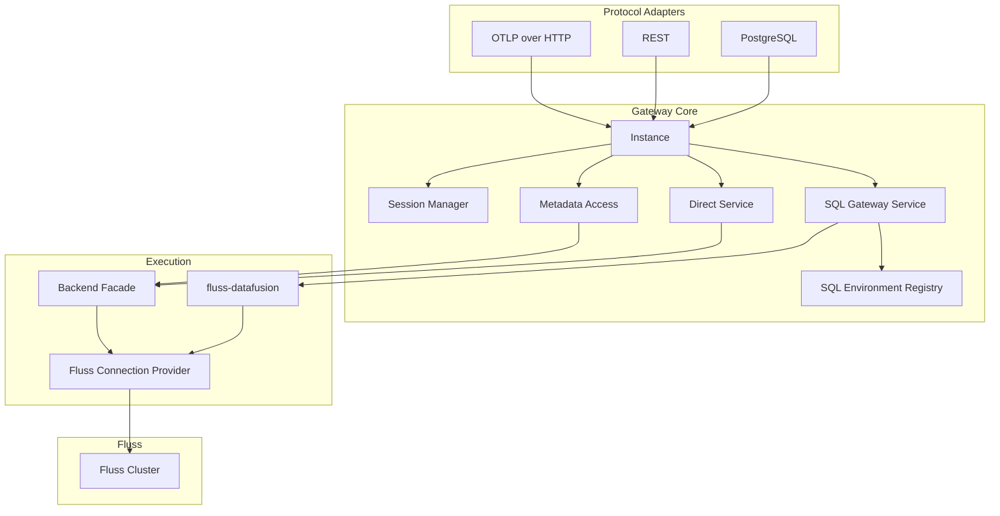

# FIP-0001: Fluss Gateway Framework

> 状态：Draft
> 
> 本文是 `fluss-gateway` 的总框架 FIP，定义 Phase 1 的共享边界、核心不变量与模块分工。
> SQL 路径详见 [`0002-sql-path.md`](./0002-sql-path.md)，REST / direct 路径详见 [`0003-rest-path.md`](./0003-rest-path.md)。

---

## 1. 摘要

`fluss-gateway` 在 Apache Fluss 之上提供一个**协议无关（protocol-agnostic）**的网关核心，
统一承载 session、SQL、operation、direct read/write、metadata 与 auth 链路，
再由 PostgreSQL、REST、OTLP over HTTP 等协议模块在边界层完成 transport、编解码、握手与兼容逻辑。

Phase 1 只交付两条主要路径：

- **SQL 路径**：PostgreSQL wire protocol，只读 SQL。
- **Direct 路径**：REST direct read/write API，其中写入是本期唯一正式写路径；OTLP over HTTP 作为同一 HTTP listener 上的 direct adapter。

本文只回答三类问题：

1. 网关整体架构如何分层。
2. 哪些能力属于共享核心，哪些能力属于协议边界。
3. SQL 与 direct 两条路径必须共同遵守哪些不变量。

---

## 2. 背景与目标

Gateway 的目标不是把所有协议都塞进一条 SQL 执行链，而是提供一个可扩展的统一接入层：

- 对 BI / IDE / JDBC 客户端，提供 PostgreSQL 兼容的只读 SQL 入口。
- 对程序化调用与摄取场景，提供 direct read/write API。
- 对未来 MySQL、Flight SQL、gRPC 等协议，保留可插补的接入方式。
- 对 `fluss-datafusion`，维持清晰的单向依赖边界：`fluss-gateway -> fluss-datafusion`。

Gateway 核心只关心中立领域模型与执行编排，不关心 PG row、HTTP body、protobuf wire type 等协议表现。

---

## 3. Phase 1 范围

### 3.1 本期交付

- PostgreSQL wire protocol for read-only SQL
- REST direct read/write API
- SQL 路径的 session / operation 生命周期管理
- PostgreSQL 兼容所需的协议适配与 SQL 环境装配
- direct write 的 at-least-once 语义
- principal 在网关内部调用链全程保留

### 3.2 本期明确不做

- MySQL wire protocol
- Arrow Flight SQL / gRPC 正式落地
- PostgreSQL SQL 写入
- schema-on-write
- gateway 侧 authorization、masking、RLS
- per-user doAs / impersonation
- 真实 multi-cluster 路由实现
- 完整事务语义
- direct write 的幂等去重能力

---

## 4. 核心架构不变量

以下约束在所有协议路径中都必须保持一致。

### 4.1 核心保持协议无关

`Instance` 是统一 facade；协议模块只做：

- transport
- 请求/响应编解码
- auth handshake
- 协议兼容行为
- 边界错误映射

核心层不直接承载 PostgreSQL、REST、OTLP 的 wire 细节。

### 4.2 SQL 协议与 direct 协议分开建模

- **SQL protocols**：PostgreSQL now，Flight SQL / MySQL later
- **Direct protocols**：REST now，OTLP over HTTP now，gRPC later

直接路径不应被强行包装成 SQL 执行，也不应复用 SQL session / operation 语义。

### 4.3 `Instance` 是统一 facade

`Instance` 统一暴露：

- session 管理
- SQL describe / execute
- running query cancel
- direct read / write
- metadata access

协议模块依赖 `Instance`，而不是直接拼装 session manager、backend、DataFusion 或连接层。

### 4.4 `fluss-datafusion` 是独立 SQL 集成库

`fluss-datafusion` 负责：

- Fluss catalog / schema / table 暴露
- DataFusion `CatalogProvider` / `SchemaProvider` / `TableProvider`
- predicate pushdown
- execution plan
- Arrow 类型桥接

`fluss-gateway` 负责：

- 协议接入
- session / operation 生命周期
- auth / principal / cluster
- `pg_catalog` 兼容
- timeout / cancel 语义
- direct read/write API

重要边界：`fluss-datafusion` 不得依赖 gateway 类型，gateway 也不应把 catalog/execution/type 逻辑吸回本仓。

### 4.5 `SessionContext` 与 `SessionVars` 分离

SQL 路径中：

- `SessionContext` 是 **per-session** 的结构性执行环境。
- `SessionVars` 是 **mutable session state** 的单一事实源。
- 每条查询在执行前基于 session 的 context clone 出 `SessionState`，再投影当前 `SessionVars`。
- 运行中的查询持有自己的不可变快照；并发 `SET` 只影响下一条查询。

因此：

- 不在运行中的 `SessionContext` 上做协议特有的 live mutation。
- direct 路径完全不创建 session。

### 4.6 direct write 语义是 at-least-once

一旦 direct write 已经 dispatch 到 backend：

- timeout / disconnect 不等于后端写入已取消
- 结果可能 unknown
- 不承诺回滚
- 调用方如需幂等，需自行承担

### 4.7 principal 必须贯穿内部链路

即使当前 Fluss 端尚未消费 principal，gateway 内部仍必须把 principal 带到：

- session / request context
- metadata access
- `FlussConnectionProvider.resolve(cluster, principal)`

这为将来的审计、doAs 与 per-principal 路由演进保留路径。

---

## 5. 部署与信任模型

Phase 1 的默认假设：

- 单租户 / 单部署
- gateway 运行在客户可信 VPC 内
- deployment boundary 即 trust boundary

Gateway 负责：

- 认证（authentication）
- 身份映射（gateway account -> Fluss account）

Gateway 不负责：

- authorization 决策
- 表/列级授权
- masking / RLS

授权裁决权完全在 Fluss。

### 5.1 身份与凭据模型

本期使用静态映射表（`config_store`）保存：

- gateway 账户
- 映射后的 Fluss 账户
- 对应 Fluss 账户凭据

因此本期的规范性设计是：

- gateway 认证通过后，映射到一个 Fluss 账户
- gateway 使用映射后的 Fluss 账户凭据访问 Fluss
- Fluss 决定该账户能读写什么

这比“全局共享单一 proxy account”更符合当前目标设计。

---

## 6. 总体分层

### 6.1 模块职责

- `instance/`：统一 facade 与请求/响应模型
- `session/`：GatewaySession、SessionVars、operation registry
- `sql/`：SQL execute/describe 编排、SQL 环境装配
- `server/postgres/`：PG transport / adapter / compatibility
- `direct/`：direct request model 与 service
- `server/rest/`：HTTP routing / JSON / Arrow IPC / OTLP boundary
- `backend/`：direct path 的 Fluss 访问编排与 metadata 读取
- `connection/`：连接解析与复用
- `auth/`：协议无关的认证模型
- `cluster/`：cluster config / 路由状态（本期仅 `default`）

---

## 7. 共享运行时概念

### 7.1 Session 与 Request

- SQL path：connection-scoped session + query-scoped operation
- Direct path：request-scoped execution context

### 7.2 Timeout 与 Cancel

- SQL path：`statement_timeout`、request timeout、cancel request 收敛到 query deadline + cancellation token
- Direct read：best-effort cancel
- Direct write：无用户级 cancel API；timeout/disconnect 只表示 gateway 停止等待

### 7.3 Metadata 一致性

SQL 与 REST 暴露的 metadata 应尽量来自一致的内部模型。

已知现实：

- SQL 路径的 `fluss-datafusion` 有自己的 metadata/cache
- gateway direct path 也会持有 metadata/cache

因此允许短暂漂移，但不允许语义模型长期分叉。

---

## 8. Shared API 形状

`Instance` 对外只暴露协议无关能力，返回 Arrow-native 或 domain-native 结果：

- SQL query -> `SchemaRef + SendableRecordBatchStream`
- SQL command -> domain command result
- direct read -> Arrow-native result
- direct write -> domain write summary
- metadata -> typed models

协议特有格式，如 PG `DataRow`、HTTP status/body、OTLP protobuf，不进入 core trait surface。

---

## 9. 与路径 FIP 的关系

### 9.1 SQL 路径 FIP 必须遵守

- PostgreSQL is read-only in Phase 1
- 每个 SQL session 独立 `SessionContext`
- `SessionVars` 是 mutable session state 的真值源
- SQL 环境差异通过 `SqlEnvironmentProvider` 注入
- `pg_catalog` / `SET` / `SHOW` / PG compatibility 属于 SQL path 文档的细节

### 9.2 REST 路径 FIP 必须遵守

- direct path 无 session
- direct write 是 Phase 1 唯一正式写路径
- multi-cluster 演进走 path prefix，不走 header
- OTLP over HTTP 是 direct adapter，不把 OTLP wire type 引入 core

---

## 10. 开口项

- `fluss-datafusion` 的 cancel 能否真正向下游 Fluss 扫描传播
- SQL 与 REST metadata cache 的 TTL/一致性策略
- direct read API 的正式形态与是否在 Phase 1 内落地
- future protocols（Flight SQL / MySQL / gRPC）如何复用相同的 shared semantics

---

## 11. 相关文档

- SQL 路径：[`0002-sql-path.md`](./0002-sql-path.md)
- REST / direct 路径：[`0003-rest-path.md`](./0003-rest-path.md)
- gateway ↔ `fluss-datafusion` 契约：[`../datafusion-contract.md`](../datafusion-contract.md)
