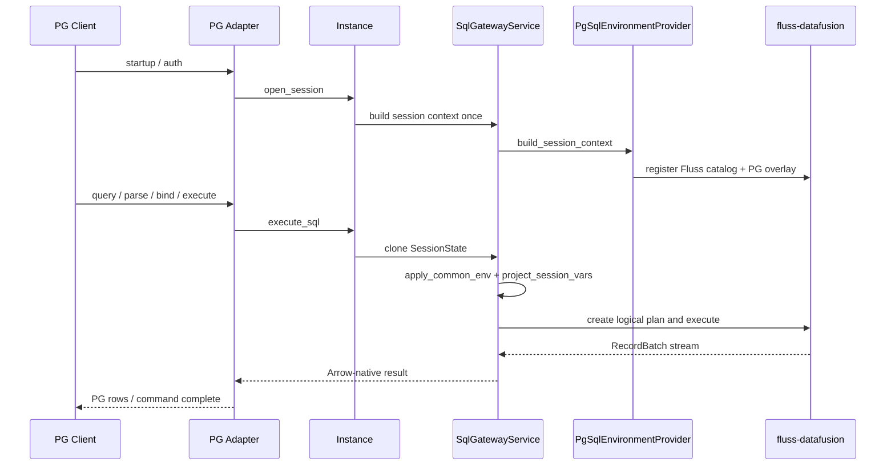

# FIP-0002: Fluss Gateway SQL Path

> 状态：Draft
> 
> 本文定义 `fluss-gateway` Phase 1 的 SQL 路径设计，覆盖 PostgreSQL wire protocol、session / operation 生命周期、DataFusion 集成边界与 PostgreSQL 兼容策略。
> 总框架见 [`0001-gateway-framework.md`](./0001-gateway-framework.md)。

---

## 1. 摘要

Phase 1 的 SQL 路径是一条**只读 PostgreSQL wire protocol** 链路：

- 协议边界由 `server/postgres/` 负责
- 核心执行编排由 `Instance` / `SqlGatewayService` 负责
- Fluss 表访问与 DataFusion 集成由 `fluss-datafusion` 负责
- PostgreSQL 兼容环境通过 `PgSqlEnvironmentProvider` 注入

这条路径的核心设计点有四个：

1. `SessionContext` 是 per-session 的结构性环境。
2. `SessionVars` 是 mutable session state 的唯一事实源。
3. 每条查询在 plan 前投影当前 session vars，而不是 live mutate 运行中的 context。
4. PostgreSQL adapter 只处理 wire / compatibility boundary，不持有 engine truth。

---

## 2. 范围与非目标

### 2.1 本期范围

- PostgreSQL wire protocol
- read-only SQL
- simple query 与 extended query flow
- session commands 所需的最小兼容（如 `SET`、`SHOW`、`BEGIN`、`COMMIT`）
- running query cancel / timeout
- BI / IDE 所需的最小 `pg_catalog` 兼容

### 2.2 本期不做

- PostgreSQL SQL 写入
- 完整事务语义
- PG 全量系统表与全部 GUC 兼容
- MySQL / Flight SQL 正式接入
- SessionContext 池化
- 通过 PG 路径暴露 direct write 能力

---

## 3. 端到端路径



---

## 4. Session 模型

### 4.1 Session 是 connection-scoped state

PostgreSQL 连接建立后，adapter 调用：

```rust
async fn open_session(&self, req: OpenSessionRequest) -> Result<SessionSnapshot>
```

`OpenSessionRequest` 至少包含：

- `principal`
- `cluster`
- `sql_environment = postgres`
- `initial_vars`
- `client_info`

### 4.2 `GatewaySession`

SQL 路径内部 session 需要保存：

- session id
- principal
- cluster
- `sql_environment`
- `SessionVars`
- operation manager
- per-session `SessionContext`
- create / access timestamps

### 4.3 `SessionVars` 是唯一真值源

`SessionVars` 至少承载：

- `statement_timeout`
- `timezone`
- `current_catalog`
- `current_schema`
- namespaced environment vars，如 `pg.search_path`

约束：

- `SET` 只改 `SessionVars`
- `SHOW` 从 `SessionVars` 读当前值
- 运行中的查询不回看后续 mutation

### 4.4 `SessionContext` 与 `SessionState`

- `SessionContext`：per-session、结构性执行环境
- `SessionState`：per-query，从 context clone 后得到的快照

每条查询的执行顺序必须是：

1. 从 session 拿到 `SessionContext`
2. clone `SessionState`
3. `apply_common_env`
4. `provider.project_session_vars`
5. 再进入 `create_logical_plan`

这是一个硬契约，因为如 `timezone` 这类变量会在 plan 期被读取。

---

## 5. SQL Gateway API 形状

SQL 路径通过 `Instance` 暴露中立 API：

```rust
async fn describe_sql(&self, req: DescribeSqlRequest) -> Result<SqlDescription>;
async fn execute_sql(&self, req: ExecuteSqlRequest) -> Result<SqlExecution>;
async fn cancel_query(&self, op_id: OperationId) -> Result<CancelResult>;
async fn list_running_queries(&self, scope: MetadataScope) -> Result<Vec<RunningQueryInfo>>;
```

返回值保持 Arrow-native：

- query -> `SchemaRef + SendableRecordBatchStream`
- command -> 领域级 command result

PG row 编码、error code、wire command tag 都留在 adapter 边界完成。

---

## 6. DataFusion 集成与 `fluss-datafusion` 边界

### 6.1 gateway 依赖的唯一接缝

Gateway 只通过两类接缝使用 `fluss-datafusion`：

- 一个共享的 `FlussDatafusion` 对象
- `register_catalog(&ctx, "fluss", ...)`

### 6.2 gateway 不拥有的能力

以下能力虽然被 SQL 路径使用，但不在 gateway 仓内实现：

- `CatalogProvider` / `SchemaProvider` / `TableProvider`
- KV / Log pushdown
- execution plan
- Arrow 类型桥接
- SQL -> Fluss metadata/cache

### 6.3 共享与隔离

共享：

- Fluss 连接
- `FlussDatafusion` 内部 metadata/cache

不共享：

- `SessionContext`
- session vars
- running operation state

---

## 7. SQL 环境提供者（Sql Environment Providers）

### 7.1 `SqlEnvironmentProvider`

SQL 协议差异不写死在 `Instance`，而通过 provider 注入。

推荐接口：

```rust
#[async_trait]
pub trait SqlEnvironmentProvider: Send + Sync {
    async fn build_session_context(
        &self,
        session: &GatewaySession,
    ) -> Result<SessionContext>;

    fn project_session_vars(
        &self,
        vars: &SessionVars,
        state: &mut SessionState,
    );
}
```

### 7.2 `PgSqlEnvironmentProvider`

`build_session_context` 的职责：

1. 创建 `SessionContext`
2. 注册 `fluss-datafusion`
3. 安装 `datafusion-pg-catalog` base objects
4. 安装 Fluss-specific `pg_catalog` overlay

`project_session_vars` 的职责：

- `timezone` -> `execution.time_zone`
- `current_catalog` / `current_schema` -> 默认 catalog/schema
- `pg.search_path` -> 本期按单元素 schema 处理

### 7.3 `apply_common_env`

所有 SQL 协议共享的环境投影必须在 core 集中处理，而不是散落在协议 adapter 中。

本期最重要的共享投影包括：

- timezone
- current catalog / schema 的共享语义
- 为未来 security/audit policy 预留的统一入口

---

## 8. PostgreSQL 边界：wire vs engine

### 8.1 判据

能由 engine 里的真实语句或真实 catalog 回答的，就不要在 wire 层硬编码。

### 8.2 adapter 负责

- startup / auth handshake
- SQL rewrite 入口调用
- bind 参数解码
- Arrow -> PG row 编码
- prepared statement 的 wire lifecycle
- `CancelRequest` 映射
- 极小量 engine 物理上答不了的 fixtures

### 8.3 engine 负责

- `SET` / `SHOW` 的语义
- `SessionVars` 的变更与读取
- `pg_catalog` / `information_schema` 兼容对象
- `version()` / `current_schema()` 等尽可能以真实对象应答

### 8.4 fixtures 的边界

本期仅保留“引擎物理上答不了”的极小集合，如：

- `BEGIN`
- `COMMIT`
- `ROLLBACK`

它们只作为 autocommit no-op，不引入真实事务状态。

---

## 9. PostgreSQL 兼容语义

### 9.1 只读约束

PostgreSQL path 在 Phase 1 只读：

- `SELECT` 支持
- `SET` / `SHOW` / `BEGIN` / `COMMIT` / `ROLLBACK` / `DISCARD` 走 command 语义
- `INSERT` / `UPDATE` / `DELETE` / DDL 一律明确拒绝

错误信息应明确指向：写入请使用 direct path。

### 9.2 `SET` / `SHOW`

- `SET`：改 `SessionVars`
- `SHOW`：从 `SessionVars` 读
- 不在 live `SessionContext` 上原地打补丁
- 下条查询在投影时生效

### 9.3 `search_path`

本期只实现单元素的 `search_path` 语义，即把它等价映射为默认 schema。

完整 PostgreSQL 的有序多元素 fallback 不是本期目标。

### 9.4 prepared statements

prepared statement 与 portal 的 wire 生命周期全部留在 PostgreSQL adapter 内部：

- per-connection
- session 关闭即释放
- 不成为 core operation 模型的一部分

---

## 10. 查询执行生命周期

### 10.1 同步执行模型

Phase 1 的 SQL path 使用同步执行模型：

- 客户端发起 execute
- gateway 返回 stream 或 command
- 不暴露“提交 job -> 轮询状态 -> 取结果”的异步作业模型

### 10.2 operation registry

registry 只保留运行中查询需要的信息：

- operation id
- statement summary
- principal
- started_at
- cancellation token

它的目的只有两个：

- `cancel_query`
- `list_running_queries`

不提供持久终态查询。

### 10.3 timeout

timeout 至少由以下来源收敛：

- `statement_timeout`
- request override

执行时应覆盖：

- plan 阶段
- stream polling 阶段

### 10.4 cancel

cancel 来源包括：

- PostgreSQL `CancelRequest`
- client disconnect
- internal timeout

都统一落到 cooperative cancel。

---

## 11. Log 表 SQL 语义

Log 表在 SQL 路径的保守语义需要固定：

- 支持 bounded scan
- Phase 1 要求 `LIMIT`
- 返回顺序固定为 offset ascending
- 默认从 earliest available offset 开始
- 不暴露 offset 伪列
- 不把 tail/read-latest 语义混入 SQL path

---

## 12. 风险与开口项

- `fluss-datafusion` cancel 是否能真正停止下游 Fluss 扫描
- BI / IDE 对 `pg_catalog` probe 的最小覆盖范围
- `DataFusion 51 -> 52` 或相关版本线验证
- prepared statement describe / execute 间的重复 parse/plan 优化是否需要后置缓存

---

## 13. 相关文档

- 总框架：[`0001-gateway-framework.md`](./0001-gateway-framework.md)
- REST / direct 路径：[`0003-rest-path.md`](./0003-rest-path.md)
- gateway ↔ `fluss-datafusion` 契约：[`../datafusion-contract.md`](../datafusion-contract.md)
