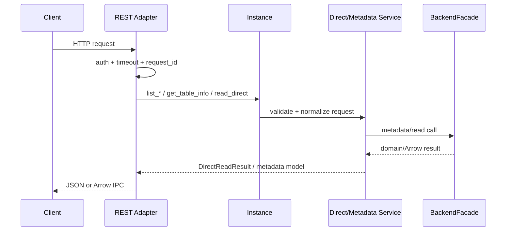
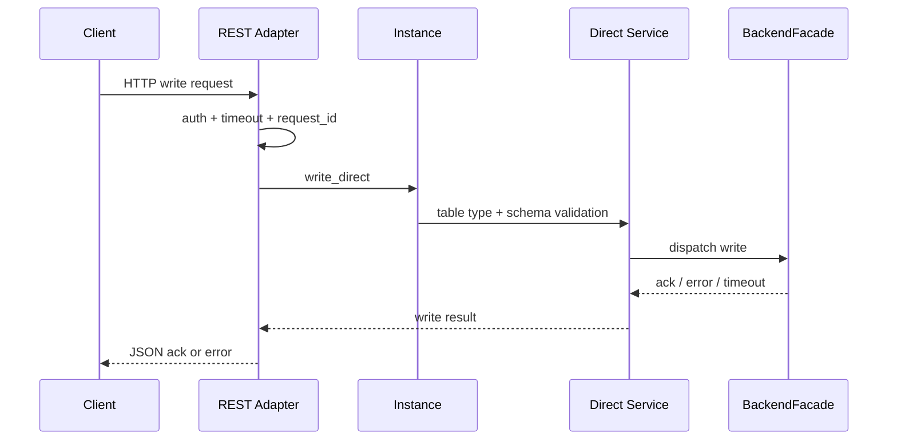

# FIP-0003: Fluss Gateway REST / Direct Path

> 状态：Draft
>
> 英文版待按本次修订同步更新：`0003-rest-path.en.md`
>
> 本文是 `fluss-gateway` 仓内 **REST / direct path 的实现级 FIP**。它在不改变总框架 FIP 的前提下，把 Phase 1 的 REST metadata / direct read / direct write / OTLP over HTTP 细化为可落地的接口与模块设计。
>
> 与上游 [FIP-32: 多协议查询网关](../../../../AiWorkSpace/fluss-fip/FIP-32/FIP-32_多协议查询网关_中文版.md) 的关系：
>
> 1. **尽量复用 FIP-32 的 REST 读接口心智模型**：table-centric 路径、JSON over HTTP、可选 Arrow IPC 响应。
> 2. **保留 gateway 当前架构约束**：REST 是 direct path，不复用 SQL session / operation 生命周期；写入能力通过 direct path 暴露。
> 3. **对 FIP-32 做最小必要扩展**：增加 cluster path prefix、direct write 端点、OTLP over HTTP 端点，以及 request-scoped timeout / cancel / error model。
>
> 总体架构见：[0001-gateway-framework.md](./0001-gateway-framework.md)
>
> 相关 SQL 路径设计见：[0002-sql-path.md](./0002-sql-path.md)

| 字段 | 内容 |
|------|------|
| Discussion thread | TBD |
| Vote thread | TBD |
| ISSUE | TBD |
| Release | TBD |

## 动机

FIP-32 已经定义了 Fluss 多协议查询网关的总体方向，并给出了 REST/HTTP API 的高层轮廓；但对 `fluss-gateway` 当前这条实现线来说，REST 路径还缺少三类关键细节：

1. **实现边界不够清晰**：FIP-32 主要描述“读网关”，而 `fluss-gateway` Phase 1 还承担 direct write 与 OTLP over HTTP ingest。若不单独细化，容易出现 REST 读、写、OTLP 三条路径在核心层混杂，或者错误复用 SQL session / operation 模型。
2. **对外契约不够精确**：请求体、响应体、内容协商、错误模型、超时/取消语义、unknown write outcome 的表现形式，都需要在实现前钉死，否则 adapter 与 core 会各自发散。
3. **与 FIP-32 的路径命名存在潜在漂移**：FIP-32 采用 table-centric 的 REST 读路径；而 gateway 的多集群演进要求 cluster path prefix。若不先定义兼容策略，后续很容易出现两套 REST 路径长期并存。

因此，本文的目标不是重写 FIP-32，而是把它在 `fluss-gateway` 仓内落成一份**尽可能详细的实现设计**，并遵守以下对齐原则：

- **读接口优先与 FIP-32 对齐**：尽量保留 `_databases` / `_tables` / `_info`、lookup / batch / prefix / scan 这套 REST 心智模型。
- **写接口采用独立命名空间扩展**：避免挤占或扭曲 FIP-32 既有读接口语义。
- **canonical path 支持 cluster prefix**，并为 `default` cluster 提供 FIP-32 兼容 alias。
- **REST 永远是 direct path**：无 session、无用户可见 operation registry、不走 SQL parser / planner。

## 公共接口

本节定义 REST/direct path 的公共 HTTP 契约。

### 1. 路径、版本与兼容策略

#### 1.1 Canonical path

多集群演进的规范路径为：

```text
/v1/clusters/{cluster}/...
```

Phase 1 实际只支持：

```text
/v1/clusters/default/...
```

#### 1.2 FIP-32 compatibility alias

为尽量不与 FIP-32 冲突，`cluster = default` 时，REST **读接口与健康检查**提供 clusterless alias；这些 alias 仅是 HTTP router 层兼容，不改变内部 request model。

| Canonical | Alias（仅 default） | 说明 |
|---|---|---|
| `GET /health` | `GET /health` | 全局健康检查，无 cluster 维度 |
| `GET /v1/clusters/default/_databases` | `GET /v1/_databases` | metadata |
| `GET /v1/clusters/default/{db}/_tables` | `GET /v1/{db}/_tables` | metadata |
| `GET /v1/clusters/default/{db}/{table}/_info` | `GET /v1/{db}/{table}/_info` | metadata |
| `GET /v1/clusters/default/{db}/{table}` | `GET /v1/{db}/{table}` | lookup |
| `GET /v1/clusters/default/{db}/{table}/prefix` | `GET /v1/{db}/{table}/prefix` | prefix scan |
| `POST /v1/clusters/default/{db}/{table}/batch` | `POST /v1/{db}/{table}/batch` | batch lookup |
| `POST /v1/clusters/default/{db}/{table}/scan` | `POST /v1/{db}/{table}/scan` | log scan |

**不提供** clusterless 写入 alias；写接口只走 canonical path，避免将来多集群语义不清。

### 2. 认证与公共请求头

REST path 支持两种边界认证方式：

- `Authorization: Bearer <token>`
- `X-API-Key: <key>`

认证结果统一映射成中立 `Principal`，再写入 `RequestExecutionContext`。

公共请求头：

| Header | 必填 | 说明 |
|---|---|---|
| `Authorization` | 否 | Bearer token，优先于 `X-API-Key` |
| `X-API-Key` | 否 | API key |
| `X-Request-Id` | 否 | 调用方提供的请求 ID；缺失时由 gateway 生成 |
| `X-Fluss-Timeout-Ms` | 否 | 请求级超时；缺省走服务端默认值，超过上限会被裁剪 |
| `Accept` | 否 | 读接口支持 `application/json`（默认）或 `application/vnd.apache.arrow.ipc` |
| `Content-Type` | 条件必填 | POST 写入/scan/batch/OTLP 请求体类型 |
| `Content-Encoding` | 否 | OTLP protobuf 支持 `gzip` |

超时规则：

- `X-Fluss-Timeout-Ms` 最小值 1ms。
- 服务端配置 `rest.default_timeout_ms` 与 `rest.max_timeout_ms`；客户端超时时间超过上限时按上限裁剪。
- 超时只影响本次 HTTP 请求的等待窗口与 request-scoped cancel，不改变写路径 at-least-once 语义。

### 3. 内容类型与内容协商

#### 3.1 读接口响应

- 默认：`application/json`
- 可选：`application/vnd.apache.arrow.ipc`

支持 Arrow IPC 的接口：

- `GET /.../{table}`（lookup）
- `GET /.../{table}/prefix`
- `POST /.../{table}/batch`
- `POST /.../{table}/scan`

metadata / health / write ack 不支持 Arrow IPC，固定返回 JSON。

#### 3.2 写接口请求

Phase 1 direct write 支持：

- `application/json`
- `application/vnd.apache.arrow.ipc`（仅 `/records`，不适用于 delete）

#### 3.3 OTLP over HTTP

- `application/x-protobuf`（Phase 1 必须支持）
- `Content-Encoding: gzip` 可选

OTLP 请求体仅在 adapter boundary 解码；OTLP wire type 不进入 `instance/` / `backend/`。

### 4. 统一 JSON 错误模型

所有 JSON 接口失败时返回统一错误体：

```json
{
  "error": {
    "code": "TABLE_NOT_FOUND",
    "message": "table db1.orders not found",
    "retryable": false,
    "request_id": "req-7f1a",
    "details": {
      "database": "db1",
      "table": "orders"
    }
  }
}
```

字段含义：

- `code`：稳定的 machine-readable 错误码
- `message`：可读错误信息
- `retryable`：是否建议自动重试
- `request_id`：最终请求 ID
- `details`：结构化上下文

建议错误码集合（Phase 1 至少覆盖）：

- `UNAUTHORIZED`
- `FORBIDDEN`
- `INVALID_ARGUMENT`
- `UNSUPPORTED_MEDIA_TYPE`
- `DATABASE_NOT_FOUND`
- `TABLE_NOT_FOUND`
- `TABLE_TYPE_MISMATCH`
- `PRIMARY_KEY_REQUIRED`
- `SCHEMA_MISMATCH`
- `FEATURE_NOT_SUPPORTED`
- `BACKEND_UNAVAILABLE`
- `DEADLINE_EXCEEDED`
- `WRITE_OUTCOME_UNKNOWN`
- `INTERNAL_ERROR`

HTTP 状态码映射：

| HTTP | 典型错误码 | 说明 |
|---|---|---|
| `400` | `INVALID_ARGUMENT` / `PRIMARY_KEY_REQUIRED` | 参数非法 |
| `401` | `UNAUTHORIZED` | 未认证 |
| `403` | `FORBIDDEN` | principal 无法映射或被拒绝 |
| `404` | `DATABASE_NOT_FOUND` / `TABLE_NOT_FOUND` | 资源不存在 |
| `409` | `TABLE_TYPE_MISMATCH` / `SCHEMA_MISMATCH` | 请求与表能力不匹配 |
| `415` | `UNSUPPORTED_MEDIA_TYPE` | Content-Type 不支持 |
| `422` | `FEATURE_NOT_SUPPORTED` | 能理解请求但当前实现不支持 |
| `500` | `INTERNAL_ERROR` | 网关内部错误 |
| `503` | `BACKEND_UNAVAILABLE` | Fluss / lake backend 暂不可用 |
| `504` | `DEADLINE_EXCEEDED` / `WRITE_OUTCOME_UNKNOWN` | 超时；对写请求可能表示结果未知 |

### 5. 统一 JSON 行编码

为避免 schema-on-write 心智，JSON 行必须按目标表 schema 解释。

| Fluss 类型 | JSON 编码 |
|---|---|
| `BOOLEAN` | `true` / `false` |
| 整数 / 浮点 | JSON number |
| `DECIMAL(p,s)` | string，如 `"123.45"` |
| `CHAR` / `STRING` | string |
| `BYTES` / `BINARY` | `{ "$binary": "BASE64" }` |
| `DATE` | `"YYYY-MM-DD"` |
| `TIME` | `"HH:MM:SS[.fff]"` |
| `TIMESTAMP` | RFC3339 / ISO8601 string |
| `TIMESTAMP_LTZ` | RFC3339 / ISO8601 string，按 UTC 解释 |
| `ARRAY<T>` | JSON array |
| `MAP<K,V>` | JSON object；仅适用于 key 可序列化为字符串的场景 |
| `ROW<...>` | JSON object |
| nullable 列 | `null` |

约束：

- 未知列名：`400 INVALID_ARGUMENT`
- 非 nullable 列缺失：`409 SCHEMA_MISMATCH`
- nullable 列缺失：按 `null` 处理
- JSON number 到具体整数位宽的截断或溢出：`409 SCHEMA_MISMATCH`
- `BYTES` / `BINARY` 一律不用裸字符串，必须显式写成 `{ "$binary": "..." }`

### 6. Health endpoint

#### 6.1 `GET /health`

用于存活/就绪检查，返回 JSON：

```json
{
  "status": "ok",
  "uptime_ms": 123456,
  "gateway_version": "0.1.0",
  "backend": {
    "status": "ok"
  }
}
```

说明：

- `200`：进程可服务，且 backend health check 成功
- `503`：进程存活但 backend 不可用
- `health` 不创建 session，不触发 metadata cache 全量刷新

### 7. Metadata API

#### 7.1 `GET /v1/clusters/{cluster}/_databases`

响应：

```json
{
  "databases": [
    { "name": "db1" },
    { "name": "db2" }
  ],
  "request_id": "req-1"
}
```

#### 7.2 `GET /v1/clusters/{cluster}/{db}/_tables`

响应：

```json
{
  "database": "db1",
  "tables": [
    { "name": "users", "table_type": "PRIMARY_KEY" },
    { "name": "events", "table_type": "LOG" }
  ],
  "request_id": "req-2"
}
```

#### 7.3 `GET /v1/clusters/{cluster}/{db}/{table}/_info`

响应：

```json
{
  "database": "db1",
  "table": "users",
  "table_type": "PRIMARY_KEY",
  "columns": [
    { "name": "user_id", "type": "STRING", "nullable": false },
    { "name": "name", "type": "STRING", "nullable": true }
  ],
  "primary_key": ["user_id"],
  "distribution": {
    "bucket_count": 8,
    "bucket_keys": ["user_id"]
  },
  "options": {
    "table.datalake.enabled": "true"
  },
  "request_id": "req-3"
}
```

metadata API 约束：

- 结果与 SQL path 的 `pg_catalog` / `information_schema` 尽量复用同一内部 metadata model。
- 允许 SQL 与 REST 各自做 cache，但必须来自同一 Fluss truth source。
- 不在 metadata 接口泄露 gateway 自身敏感配置（如 lake credential override）。

### 8. Direct read API

本节尽量对齐 FIP-32 的 REST 读接口，但内部一律映射到 `DirectReadRequest`。

#### 8.1 Lookup

```text
GET /v1/clusters/{cluster}/{db}/{table}?pk.{col}={value}[&pk.{col2}={value2}][&columns=a,b,c]
```

语义：

- 仅适用于 `PRIMARY_KEY` 表
- 必须提供**完整主键**的等值约束
- `columns` 可选，表示投影列；未提供则返回全列

成功响应（JSON）：

```json
{
  "database": "db1",
  "table": "users",
  "found": true,
  "row": {
    "user_id": "u1",
    "name": "Alice"
  },
  "request_id": "req-4"
}
```

未命中：

```json
{
  "database": "db1",
  "table": "users",
  "found": false,
  "row": null,
  "request_id": "req-4"
}
```

Arrow IPC 响应：

- `Accept: application/vnd.apache.arrow.ipc`
- body 为 0 或 1 行 `RecordBatch` stream
- 不再包 JSON envelope

错误：

- 缺少任一 PK 列：`400 PRIMARY_KEY_REQUIRED`
- 目标表非 PK 表：`409 TABLE_TYPE_MISMATCH`

#### 8.2 Batch lookup

```text
POST /v1/clusters/{cluster}/{db}/{table}/batch
Content-Type: application/json
```

请求体：

```json
{
  "keys": [
    { "user_id": "u1" },
    { "user_id": "u2" }
  ],
  "columns": ["user_id", "name"],
  "fail_fast": false
}
```

约束：

- 仅适用于 `PRIMARY_KEY` 表
- `keys` 非空，单请求最多 1000 个 key
- 每个 key 必须提供完整主键

成功响应（JSON）：

```json
{
  "database": "db1",
  "table": "users",
  "rows": [
    { "user_id": "u1", "name": "Alice" },
    { "user_id": "u2", "name": "Bob" }
  ],
  "row_count": 2,
  "request_id": "req-5"
}
```

Arrow IPC 响应：

- body 为 `RecordBatch` stream
- 行顺序按 backend 实际返回；Phase 1 不额外承诺与输入 key 顺序完全一致

#### 8.3 Prefix scan

```text
GET /v1/clusters/{cluster}/{db}/{table}/prefix?prefix={value}[&prefix_b64={base64}][&limit={n}][&columns=a,b]
```

语义：

- 仅适用于支持 prefix scan 的 `PRIMARY_KEY` 表
- Phase 1 只保证 **单列 STRING / BYTES 主键**上的 prefix scan
- STRING 主键用 `prefix`
- BYTES 主键用 `prefix_b64`
- `limit` 缺省值由服务端配置提供，最大值由 `rest.max_scan_limit` 限制

成功响应（JSON）：

```json
{
  "database": "db1",
  "table": "users",
  "rows": [
    { "user_id": "u100", "name": "Alice" },
    { "user_id": "u101", "name": "Bob" }
  ],
  "row_count": 2,
  "request_id": "req-6"
}
```

错误：

- 主键不是单列 STRING/BYTES：`422 FEATURE_NOT_SUPPORTED`
- 目标表非 PK 表：`409 TABLE_TYPE_MISMATCH`

#### 8.4 Log scan

```text
POST /v1/clusters/{cluster}/{db}/{table}/scan
Content-Type: application/json
```

请求体：

```json
{
  "start_offset": 0,
  "limit": 1000,
  "columns": ["event_time", "payload"]
}
```

语义：

- 仅适用于 `LOG` 表
- 是 **bounded log scan**，必须带 `limit`
- `start_offset` 为逻辑起始偏移；Phase 1 不暴露分区/桶级选择

成功响应（JSON）：

```json
{
  "database": "db1",
  "table": "events",
  "start_offset": 0,
  "rows": [
    { "event_time": "2026-07-01T12:00:00Z", "payload": {"k":"v"} }
  ],
  "row_count": 1,
  "request_id": "req-7"
}
```

错误：

- 目标表非 LOG 表：`409 TABLE_TYPE_MISMATCH`
- `limit <= 0` 或超上限：`400 INVALID_ARGUMENT`

### 9. Direct write API

本节定义 Phase 1 REST 写接口。REST 写始终走 direct path，不经过 SQL。

#### 9.1 `POST /v1/clusters/{cluster}/{db}/{table}/records`

语义：

- 对 `PRIMARY_KEY` 表：`KvUpsert`
- 对 `LOG` 表：`LogAppend`

这是 **按表类型决定写模式** 的统一入口，避免把 FIP-32 的读接口语义打散，也避免额外暴露不必要的 SQL/DML 名词。

##### 9.1.1 JSON 请求

```text
POST /v1/clusters/{cluster}/{db}/{table}/records
Content-Type: application/json
```

请求体：

```json
{
  "rows": [
    { "user_id": "u1", "name": "Alice" },
    { "user_id": "u2", "name": "Bob" }
  ]
}
```

约束：

- `rows` 非空
- 未知列名：拒绝
- 非 nullable 列缺失：拒绝
- 不做 schema-on-write；表必须预先存在

##### 9.1.2 Arrow IPC 请求

```text
POST /v1/clusters/{cluster}/{db}/{table}/records
Content-Type: application/vnd.apache.arrow.ipc
```

约束：

- 仅用于 `/records`，不适用于 delete
- Arrow schema 中列名必须与目标表列名对齐
- 列类型必须可安全映射到目标 Fluss schema
- Phase 1 不支持“只提供部分列并依赖默认值”的 Arrow 写入模式

##### 9.1.3 成功响应

```json
{
  "acknowledged": true,
  "database": "db1",
  "table": "users",
  "write_mode": "kv_upsert",
  "input_rows": 2,
  "accepted_rows": 2,
  "request_id": "req-8"
}
```

`write_mode` 取值：

- `kv_upsert`
- `log_append`

#### 9.2 `POST /v1/clusters/{cluster}/{db}/{table}/records:delete`

语义：

- 仅适用于 `PRIMARY_KEY` 表
- 映射为 `KvDelete`

请求体：

```json
{
  "keys": [
    { "user_id": "u1" },
    { "user_id": "u2" }
  ]
}
```

成功响应：

```json
{
  "acknowledged": true,
  "database": "db1",
  "table": "users",
  "write_mode": "kv_delete",
  "input_rows": 2,
  "accepted_rows": 2,
  "request_id": "req-9"
}
```

错误：

- 非 PK 表 delete：`409 TABLE_TYPE_MISMATCH`
- key 缺少完整主键：`400 PRIMARY_KEY_REQUIRED`

### 10. OTLP over HTTP API

OTLP 与 REST 共享同一个 axum listener，但作为单独的 direct adapter 暴露。

#### 10.1 Canonical path

```text
POST /v1/clusters/{cluster}/otlp/v1/logs
POST /v1/clusters/{cluster}/otlp/v1/metrics
POST /v1/clusters/{cluster}/otlp/v1/traces
```

#### 10.2 Compatibility alias（仅 default）

为了兼容常见 OTLP exporter 的 endpoint 配置习惯，可为 `default` cluster 提供：

```text
POST /v1/logs
POST /v1/metrics
POST /v1/traces
```

这些 alias 仅是 router 层展开到 `default` cluster；内部仍构造带 cluster 的 `RequestExecutionContext`。

#### 10.3 输入与边界约束

- `Content-Type: application/x-protobuf`
- `Content-Encoding: gzip` 可选
- 在 HTTP boundary 解码 OTLP protobuf
- 每个 signal 都映射到一个**固定配置目标表**
- 进入 `Instance.write_direct` 前，OTLP payload 必须被适配成 canonical `LogAppend`
- OTLP wire type 不得进入 `instance/` / `backend/`

#### 10.4 目标表映射

目标表由 gateway 配置提供，例如：

```toml
[otlp.logs]
table = "observability.logs_raw"

[otlp.metrics]
table = "observability.metrics_raw"

[otlp.traces]
table = "observability.traces_raw"
```

Phase 1 约束：

- 每个 signal 对应固定单表
- table 必须预先存在
- adapter 只负责解码与字段适配，不负责自动建表

#### 10.5 OTLP 响应

OTLP 响应保持 OTLP 协议形状；若 gateway 需要表达部分成功/失败，通过对应 `Export*ServiceResponse` 的 partial-success 机制承载。对外语义仍继承 direct write 的 at-least-once 模型。

## 提议改动

本节定义 REST/direct path 的实现细节。

### 1. 统一内部请求模型

REST path 不直接调用 backend；它只负责把 HTTP 请求规整为中立 request model，再交给 `Instance`。

```rust
struct RequestExecutionContext {
    principal: Principal,
    cluster: ClusterName,
    deadline: Option<Instant>,
    cancellation_token: CancellationToken,
    request_id: String,
}

enum DirectReadRequest {
    Lookup {
        ctx: RequestExecutionContext,
        table: TableRef,
        key: Vec<ScalarValue>,
        projection: Option<Vec<usize>>,
    },
    BatchLookup {
        ctx: RequestExecutionContext,
        table: TableRef,
        keys: Vec<Vec<ScalarValue>>,
        projection: Option<Vec<usize>>,
        fail_fast: bool,
    },
    PrefixScan {
        ctx: RequestExecutionContext,
        table: TableRef,
        prefix: Vec<u8>,
        limit: Option<usize>,
        projection: Option<Vec<usize>>,
    },
    LogScan {
        ctx: RequestExecutionContext,
        table: TableRef,
        start_offset: i64,
        limit: usize,
        projection: Option<Vec<usize>>,
    },
}

enum DirectWriteRequest {
    KvUpsert {
        ctx: RequestExecutionContext,
        table: TableRef,
        rows: Vec<RowData>,
    },
    KvDelete {
        ctx: RequestExecutionContext,
        table: TableRef,
        keys: Vec<Vec<ScalarValue>>,
    },
    LogAppend {
        ctx: RequestExecutionContext,
        table: TableRef,
        rows: Vec<RowData>,
    },
}
```

设计原则：

- REST / OTLP 只做 boundary parse / decode / encode
- direct path 显式携带 `principal` 与 `cluster`
- 不依赖 session，不复用 SQL operation registry

### 2. 内部模块与职责

建议 REST 路径按以下目录组织：

```text
src/server/rest/
  mod.rs
  router.rs           # axum Router 组装与 alias 展开
  extractors.rs       # auth、timeout、request_id、content negotiation
  handlers/
    health.rs
    metadata.rs
    read.rs
    write.rs
    otlp.rs
  codec/
    json_rows.rs      # JSON <-> RowData / ScalarValue
    arrow_ipc.rs      # Arrow IPC read/write body
    errors.rs         # 统一 JSON error body
  response.rs         # JSON / Arrow / OTLP response builders
```

配套核心模块：

```text
src/direct/
  requests.rs
  service.rs

src/backend/
  facade.rs
  read.rs
  write.rs

src/auth/
  authenticator.rs
  config_store.rs
```

职责边界：

- `server/rest/*`：HTTP 协议层
- `direct/service.rs`：direct request orchestration、表类型校验、schema 校验、错误归一化
- `backend/*`：调用 Fluss client / lake / metadata 能力
- `auth/*`：REST 边界认证与 principal 解析

### 3. 端到端时序

#### 3.1 Metadata / read 请求



#### 3.2 Write 请求



### 4. metadata 共享策略

为避免 REST 与 SQL metadata drift：

- metadata truth source 统一来自 `BackendFacade` / 共享 metadata cache
- `GET _databases` / `_tables` / `_info` 与 SQL `pg_catalog` overlay 尽量复用同一内部模型
- REST handler 不自行拼表结构、主键信息或表类型判断

### 5. direct read 规划与限制

#### 5.1 Lookup

- handler 负责解析 `pk.*` query 参数
- `direct/service` 根据 `_info` 中的主键顺序生成 `Vec<ScalarValue>`
- backend 最终调用 point lookup

#### 5.2 Batch lookup

- 由 handler 解析 `keys[]`
- Phase 1 上限 1000 keys / request
- `fail_fast = true` 时，单 key 转换失败立即整请求报错；否则允许把转换失败视作整请求 `400`

#### 5.3 Prefix scan

- 只在底层 client 已支持 prefix scan 时开放
- 若底层能力缺失，返回 `422 FEATURE_NOT_SUPPORTED`

#### 5.4 Log scan

- 只支持 bounded scan，不做长连接 tailing
- `limit` 必填，超上限直接拒绝
- direct path 不引入 SQL `LIMIT` / planner；`limit` 是 direct 参数，不是 SQL 语法元素

### 6. direct write 规划与限制

#### 6.1 按表类型决定写模式

`POST /records` 不要求客户端显式声明 `mode`：

- `PRIMARY_KEY` 表 -> `KvUpsert`
- `LOG` 表 -> `LogAppend`

这样可以避免对外暴露多余且容易冲突的写动作命名，同时让 REST 写路径在 JSON/Arrow/OTLP 上共享同一条 canonical write 语义。

#### 6.2 删除单独成端点

`KvDelete` 单独做成 `/records:delete`，原因：

- delete 只适用于 PK 表
- delete body 只携带 key，不携带 row
- 若与 upsert/append 混入 `/records`，会让 schema 与验证逻辑复杂化

#### 6.3 写入 schema 校验

direct/service 必须在 dispatch 前完成：

- 表存在性校验
- 表类型校验
- 列名校验
- nullable 校验
- 值类型到目标 Fluss schema 的转换校验

任何 pre-dispatch 失败都不得进入 backend，避免在 timeout / unknown write outcome 语义下放大不必要的不确定性。

### 7. OTLP 适配层设计

#### 7.1 适配阶段

OTLP adapter 负责：

1. 解压（如 `gzip`）
2. 解码 OTLP protobuf
3. 依据 signal 类型选择目标表
4. 把 OTLP payload 映射为目标表的一批 canonical row
5. 构造 `DirectWriteRequest::LogAppend`
6. 调用 `Instance.write_direct`

#### 7.2 适配边界

适配完成后：

- `instance/` 只看见 `LogAppend`
- `backend/` 只看见目标表 + `RowData`
- OTLP protobuf struct、partial-success 逻辑、HTTP content-type 只停留在 adapter 层

### 8. timeout、disconnect 与 cancel 语义

#### 8.1 读路径

- request-scoped `deadline` + `CancellationToken`
- client disconnect / timeout / internal cancel 时，gateway 应停止本地处理并向下游 best-effort 传播取消
- 对外只承诺 **best-effort cancel**，不承诺底层 Fluss 扫描一定被真正停止

#### 8.2 写路径

- 不提供用户级 cancel API
- request timeout 只代表客户端不再等待
- 一旦写入已 dispatch 到 backend，disconnect / timeout **不等于** 后端写入已取消
- 若 timeout 发生在 dispatch 之后，响应应为 `504 WRITE_OUTCOME_UNKNOWN`

建议 `details` 字段包含：

```json
{
  "dispatch_started": true,
  "outcome": "unknown"
}
```

若 timeout 发生在 dispatch 之前，可返回普通 `504 DEADLINE_EXCEEDED`，不带 `unknown` 语义。

### 9. observability

每个 REST / OTLP 请求至少记录：

- `request_id`
- `principal`
- `cluster`
- endpoint 模板
- HTTP status
- internal error code
- elapsed time
- `table`（如适用）
- `write_mode` / `read_mode`（如适用）

要求：

- 原始 `principal` 必须进入 tracing span
- direct write 的 unknown outcome 必须单独打标，便于后续排障

## 兼容性、废弃与迁移计划

- 本文不是对 FIP-32 的公开推翻，而是 `fluss-gateway` 仓内的实现级细化。
- **读接口**：尽量沿用 FIP-32 语义，并为 `default` cluster 提供 clusterless alias。
- **写接口**：是对 FIP-32 读网关模型的新增扩展，不与既有读接口复用路径。
- **canonical path**：统一收敛到 `/v1/clusters/{cluster}/...`；future multi-cluster 到来时，clusterless alias 可以保留为 `default` cluster 兼容层，也可以由反向代理重写。
- 不提供 header-based cluster routing，也不计划从 header 方案迁移。
- 不提供 direct write 幂等去重或 idempotency-key；调用方若需要 exactly-once 体验，必须自行在业务层实现。

## 测试计划

实现需要以 integration tests 为主，覆盖以下矩阵。

### 1. Metadata API

- `GET /health`
- `GET _databases`
- `GET _tables`
- `GET _info`
- 验证 canonical path 与 alias 返回一致结果

### 2. Direct read

- lookup：命中 / 未命中 / 主键缺失 / 非 PK 表
- batch lookup：1 key / 多 key / 上限 / schema 错误
- prefix scan：支持表 / 不支持表 / STRING / BYTES 主键
- log scan：bounded 成功 / limit 非法 / 非 LOG 表
- JSON 与 Arrow IPC 返回一致

### 3. Direct write

- PK 表 `/records` -> `KvUpsert`
- LOG 表 `/records` -> `LogAppend`
- PK 表 `/records:delete` -> `KvDelete`
- JSON / Arrow IPC 写入成功路径
- schema mismatch / unknown column / non-nullable missing
- dispatch 前 timeout 与 dispatch 后 unknown outcome 区分

### 4. OTLP over HTTP

- logs / metrics / traces protobuf ingest
- gzip 请求体
- signal -> fixed table 路由
- adapter 后只产生 `LogAppend`，不泄漏 OTLP wire type

### 5. 边界与一致性

- REST 请求不创建 SQL session
- REST 请求不登记 SQL operation
- SQL metadata 与 REST metadata 一致
- cancel / disconnect 对 direct read 为 best-effort，对 write 不承诺取消成功

## 被否决的替代方案

### 1. 完全改成资源风格 `/databases/{db}/tables/{table}`，放弃 FIP-32 的 `_databases/_tables/_info`

否决原因：虽然纯 REST 资源风格更整齐，但会显著增加与 FIP-32 的接口漂移。当前实现优先保持 table-centric 与现有命名兼容，再通过 cluster prefix 解决多集群预留。

### 2. 让 REST 复用 SQL session / operation 生命周期

否决原因：REST direct path 是 request-scoped，不是 connection-scoped。复用 SQL session 只会引入错误抽象，并让超时/取消语义更混乱。

### 3. 把写入塞进 FIP-32 既有读端点语义里

否决原因：读接口的 lookup / batch / scan 语义已相对稳定。写接口应使用独立路径扩展，避免对读路径造成含义污染。

### 4. 用 header 而不是 path prefix 指定 cluster

否决原因：项目明确要求 REST multi-cluster 演进采用 path prefix；同时 path prefix 与 FIP-32 兼容 alias 可以共存，而 header 方案会产生第三套接口模型。
